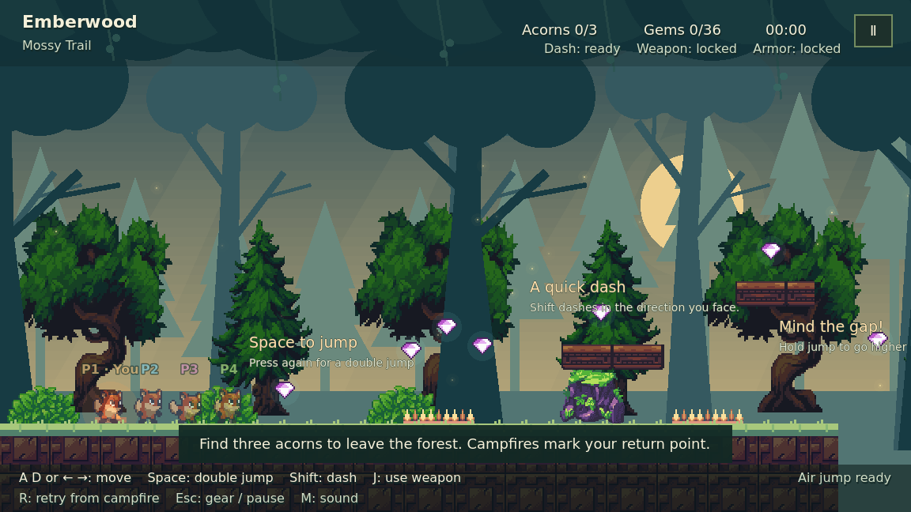
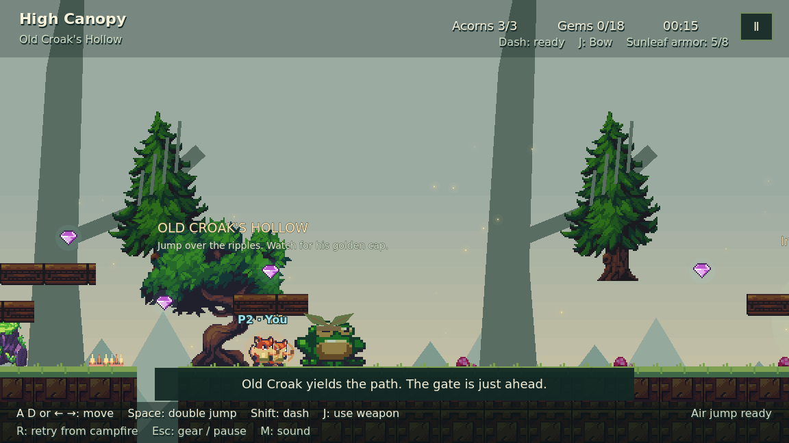

# LAN co-op

Emberwood adds **2–4 players, with one computer per player** (available since 1.4.0).
Each computer runs the original graphical game. Solo play is still available.

1. Install the same Emberwood version on every computer and connect to the same
   Wi-Fi or wired network.
2. Choose **LAN co-op · 2–4 players** on the title screen.
3. One player chooses **Host a game**. The lobby displays the host's address.
4. Everyone else enters that address and chooses **Join game**.
5. After everyone joins, the host chooses **Start co-op**.

If the host has several network adapters, use the address belonging to the shared
Wi-Fi/Ethernet network. The other addresses can belong to virtual adapters.
`127.0.0.1` only connects to another instance on the same computer. A connection
error returns to a usable menu; open LAN co-op to try again. The host must still
be in the lobby, with an available player slot. Firewall rules must allow the
game's UDP port **24642** on the local network. Networks that isolate wireless
clients can prevent computers from connecting. No internet account is required.

LAN play is designed to be cross-compatible between Linux and macOS when every
computer runs the same Emberwood version and protocol. Keep all players on the
same release when joining a session. Physical cross-platform network testing
should be recorded when performed.

## Team rules

- Every player controls a numbered fox and has their own following camera.
- Acorns, gems, secrets, camps, equipment, armor blocks and guardian hearts are
  shared. There is no player collision or friendly fire. Movement, dash and
  weapon cooldowns belong to each fox.
- A tumble, defeat or **R** returns the whole party to its shared camp. Reaching
  an open gate finishes the chapter for everyone.
- **Esc / P** pauses or resumes the whole party. Losing window focus also pauses
  the party. Release held controls before continuing.
- The host chooses team gear, continues chapters and restarts the adventure.
  Guests can read the gear menu but cannot change those choices.
- Sound and Gentle motion apply only to the current computer. **M** toggles sound.
- Players join before the adventure starts. Guests can leave from the pause or
  results menu. If the host closes the session, everyone returns to the title.
  A remaining host can continue after a guest leaves; there is no host migration.
- Co-op results do not replace solo best times. There is no mid-adventure save.



## Implementation and design

The existing forest menus, bundled DejaVu fonts, and SunnyLand fox art are reused.
Colored player numbers and a local “You” label distinguish the foxes; labels have
outlines for contrast. Starting foxes are spaced apart so labels remain readable.
The menu explains the shared retry rule before a session starts.

`scripts/lan.gd` owns session state and Godot ENet transport. UDP 24642 carries
fixed control masks from guests to the host. The host runs the existing fixed-step
physics and all pickups, damage, equipment, terrain and guardian logic. Guests
render authoritative snapshots at 30 Hz, with an independent camera and local
accessibility settings. Snapshots use fixed field lists, DEFLATE compression,
1,000-byte chunks and bounded reassembly; object deserialization is disabled.
Reliable control changes use a separate channel from snapshots. Input expires
if its heartbeat is lost. Pauses, retries and lost focus clear or block held input
until release. A session or connection timeout returns to the title.

The current format is protocol 1. There is no matchmaking, automatic discovery,
chat, split-screen, controller/touch support, or added runtime dependency.

## Verification — November 15, 2026

Observable acceptance criteria were independent control for 2–4 players, shared
world/progress, correct directions and input release, readable menus, complete
failure/retry and chapter loops, local settings, and recoverable connection errors.

- **34 independent-process network checks:** two/three/four-player admission,
  occupied port, invalid address, full/in-progress rejection, timeout, independent
  movement, stale inputs, projectiles, shared pickups/camp, authorization,
  pause/retry, local Gentle motion, guardian state, chapter/ending/restart,
  disconnect and rehosting. The headless regression uses isolated saved data.
- **226 native control scenarios:** 133 in the four-instance audit, 90 in the
  extra two-instance audit and three focused title-mouse checks, run against the extracted **1.4.0 release runtime and
  resource pack**. Real X11 keyboard/mouse events exercised controls, every
  alternate movement/jump/dash binding, all 13 gear choices by keyboard and mouse,
  five guest weapons, connection forms, menus, focus loss, failure/retry, endings
  and exits. Rendered frames/contact sheets were inspected. See the
  [binding inventory](CONTROLS.md) and [individual coverage table](LAN_CONTROLS.csv).
- Actual host and guest audio captures measured on/muted/restored peaks of
  **2425 / 0 / 2425**. Settings are independent. A mute flag alone was not used
  as audio proof.
- A guest defeated a guardian by moving and pressing **J** through the native
  window, during the guardian's real rest phases. Both screens showed the
  victory/open gate. Fixtures supplied the arena and gear, not the defeat.
- Automated solo regressions passed: fox physics (including 30/60/120 Hz dash),
  359 game integration checks, 84 equipment checks, 118 loadout checks,
  30 contact/bounce checks, 191 guardian checks, 26 later-weapon checks and the
  full **20-level campaign / six guardians**, using gameplay inputs, in **07:47**
  with zero retries. Earlier affected suites also passed arrows, 62 armor checks,
  438 monster checks, and the original boss battle. The added native key-repeat
  regression proves one jump/dash/shot per physical press.
- GDScript formatting and lint passed across `scripts` and `tests`; all six
  changed Python tools passed Ruff lint/format. Asset validation passed 926 images
  and 1,061 local links. Shell syntax, launcher executable permission, Zed task,
  desktop entry, release checksums, APT dependency simulation and Lintian passed.
  Unchanged `build_asset_catalog.py` / `check_assets.py` have pre-existing Ruff
  import/format issues; they were not reformatted as part of LAN work.
- The existing **Applications → Emberwood** shortcut was refreshed and actually
  launched via its installed desktop entry. Its title and LAN menu were captured
  and inspected. The package was extracted and exercised; no system package
  database replacement was necessary for the existing source-based shortcut.



### Game checklist assessment

| Area | Result and evidence |
| --- | --- |
| Core loop/rules | Passed host/join/start, shared items, guardian victory, failure/retry, Continue and both restart paths. Rules are visible before joining. |
| Physics | Existing fixed-step terrain controller runs for every host-side fox. Directions, jump height/double-jump limit, dash, contact, platforms and full campaign regressions passed. |
| Interaction | Separate input/cooldowns, shared rewards once, all weapon types, gear restrictions, held input and release recovery passed. |
| Navigation/camera | Each screen follows its own fox; guest gate completion and all chapter paths passed. No player collision blocks routes. |
| State/consistency | Lobby, connecting, playing, paused, retry, chapter complete, won, leave and reconnect exercised. Team reset and shared counters verified. |
| Feel/accessibility | Visible focus, numbered foxes, 800×600 pause menu, local sound output and Gentle motion inspected. |
| Polish/discovery | Existing secrets retained and shared. No new easter eggs were needed for LAN scope. Label spacing and invalid-address editing were corrected during dogfooding. |
| Robustness/performance | Packet sizing/reassembly, stale input expiry, timeout, join capacity, disconnect and resize checked. Hardware GPU performance and long multi-hour sessions were not benchmarked. |
| Playtest | Real input covered movement/combat/failure/retry/menus and a guest boss win. Automated inputs completed all 20 levels; native result-menu fixtures did not constitute a manual full-campaign run. |

### Limits and recorded diagnostics

All multiplayer instances ran on one Linux x86-64 computer over loopback sockets,
with separate processes, windows and saved data. **A connection between separate
physical computers, Wi-Fi/router/firewall behavior, Windows, macOS and ARM remain
unverified.** Tests do not establish internet play or latency tolerance beyond LAN
conditions. Xvfb software rendering does not establish performance on every PC.

Godot 4.5.1's release runtime prints an engine signal-disconnect diagnostic when
clearing a previously used RPC node on leaving a session. The same lifecycle
still passed leave/rehost/rejoin tests, with no script error or observed gameplay
failure. A focused packaged-runtime probe reproduced it. The upstream
[scene-cache implementation](https://github.com/godotengine/godot/blob/4.5.1-stable/modules/multiplayer/scene_cache_interface.cpp#L272)
disconnects a callable without the argument bound when connecting it; this is the
identified engine-level cause. The editor runtime's headless audit does not emit
that diagnostic. No engine patch or broad error suppression is included.
Xvfb also reports unsupported VSync. These logs are retained, not represented as
an entirely error-free exported run.

The installed-entry smoke test verified launch and navigation. Its synthetic
window-manager close did not complete without a real window manager; the owned
test process was explicitly stopped afterward. In-game Leave/Close LAN actions
were verified separately. Ordinary desktop window-manager close remains outside
that smoke test.

## Reproduce locally

```sh
# Engine import and static diagnostics
./emberwood --headless --editor --import --quit
gdformat --check scripts tests
gdlint scripts tests
ruff check tools/build_linux_package.py tools/install_app.py tools/run_game_tests.py tools/lan_audit.py tools/lan_native_audit.py tools/lan_edge_audit.py
ruff format --check tools/build_linux_package.py tools/install_app.py tools/run_game_tests.py tools/lan_audit.py tools/lan_native_audit.py tools/lan_edge_audit.py
python3 tools/check_assets.py --pixels

# Headless tests, with isolated saved data
python3 tools/run_game_tests.py
python3 tools/lan_audit.py

# Native audit: Python Xlib/Pillow, Xvfb, PulseAudio-compatible server and
# pactl/parec are required. See tool paths at the top of the audit scripts.
python3 tools/lan_native_audit.py
python3 tools/lan_edge_audit.py

# Refresh the existing Applications entry; build the shareable installer
python3 tools/install_app.py
python3 tools/build_linux_package.py --runtime /path/to/linux_release.x86_64
```

On this workstation the Python tools are in
`~/.local/share/phippy-tools/venv/bin/`. Native audit artifacts and audio are in
`build/lan-audit/native/` and `build/lan-audit/edges/`; headless logs are in
`build/lan-audit/network/`. Setting `EMBERWOOD_TEST_APP_BIN` and
`EMBERWOOD_TEST_PACK` runs the native fixture against the extracted release rather
than the development launcher. The fixture is never exported in the package.
Test data and captures are excluded from game exports and Git; selected images
and the completed coverage table are committed here.
